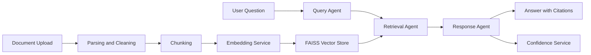

# Proposed Architecture

**Status:** Proposed baseline; components marked as planned are not yet implemented.

The initial scaffold currently supports document upload, text extraction for PDF/DOCX/TXT, text cleaning, character-based chunking, and a baseline query endpoint. Embeddings, FAISS retrieval, grounded answer generation, persistence, and the complete UI are planned work.
